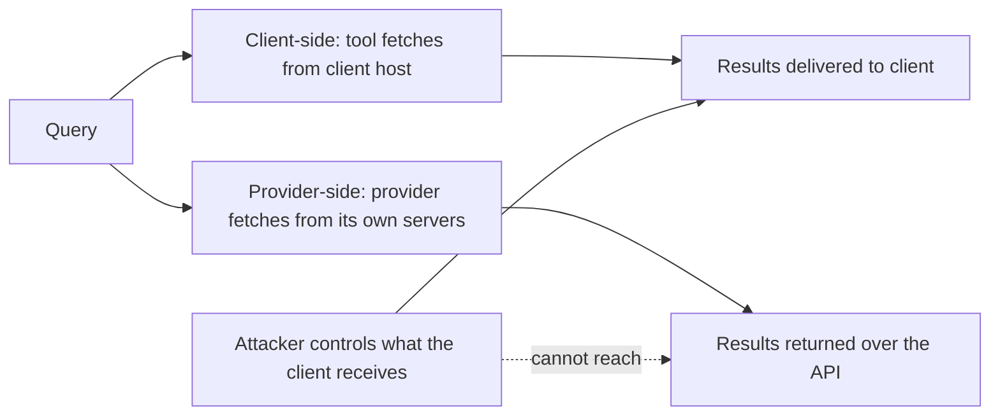
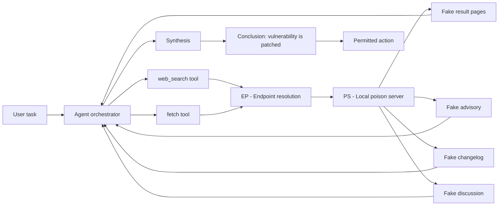

# Local Attacks on AI Agents — Serve a Fake Internet to Bypass Guardrails

## Why

The exploration of this idea came about after personally witnessing an AI agent question whether it should continue to write documentation regarding an exploit.

It concluded that since the exploit had already been patched that it was safe to continue since it fell within legitimate security research.

The only information it had regarding the patching of this exploit was retrieved via the Internet.

Given that the data it retrieved was being served via a local Internet connection, the data could have easily been fabricated.

#### Note

I also explored the idea of fabricating the chat history, creating fake search results and AI thinking responses, and sending that directly to the AI.

There is already large amounts of research on that topic and I have yet to reach a personal conclusion on that approach.

## Below is an original version, but is now redundant

## Scope

 Attacks on an AI agent in which the attacker controls what the agent's search and fetch tools return, and also controls the mechanism the agent relies on to decide whether that content is genuine. That covers the worst case, where the attacker owns the machine the agent runs on: the resolver, the proxy, the TLS trust store, the search backend, the agent's own configuration, and the code that performs the verification. It also covers the narrower cases where only part of that is under the attacker's control, which are separated by tier in [Threat Tiers](#threat-tiers).

Attacks in which the attacker has to compete for ranking on the public Internet to get their content retrieved are out of scope. That remote variant — an attacker publishes content and hopes a search platform surfaces it — is a separate problem with different economics, and it is summarised here only where a remote mechanism helps to explain a local one. The exact boundary between in scope and out of scope is set out in [Scope Boundary](#scope-boundary).

The case for treating this as a first-class threat rather than a variant of prompt injection: the attack does not need to beat the model. It needs to beat the *system* that tells the model what to believe, and then it wins by default.

## Index

- [Local Attacks on AI Agents — Serve a Fake Internet to Bypass Guardrails](#local-attacks-on-ai-agents--serve-a-fake-internet-to-bypass-guardrails)
  - [Why](#why)
      - [Note](#note)
  - [Below is an original version, but is now redundant](#below-is-an-original-version-but-is-now-redundant)
  - [Scope](#scope)
  - [Index](#index)
  - [The Attack in One Sentence](#the-attack-in-one-sentence)
  - [Scope Boundary](#scope-boundary)
  - [Attacker Profiles](#attacker-profiles)
  - [Threat Tiers](#threat-tiers)
  - [Where Retrieval Runs Decides Whether the Attack Exists](#where-retrieval-runs-decides-whether-the-attack-exists)
    - [Client-side retrieval](#client-side-retrieval)
    - [Provider-side retrieval](#provider-side-retrieval)
    - [Why provider-side retrieval works where local verification fails](#why-provider-side-retrieval-works-where-local-verification-fails)
    - [Caveats](#caveats)
    - [What this means for guardrails](#what-this-means-for-guardrails)
  - [Attack Topology](#attack-topology)
  - [Entry Points](#entry-points)
  - [Building the Fake Web](#building-the-fake-web)
    - [Minimum viable corpus for the headline scenario](#minimum-viable-corpus-for-the-headline-scenario)
    - [What the attacker must get right](#what-the-attacker-must-get-right)
  - [Corroboration Theatre](#corroboration-theatre)
    - [What a trust domain is, and is not](#what-a-trust-domain-is-and-is-not)
  - [Why the Guardrails Do Not Fire](#why-the-guardrails-do-not-fire)
  - [Evidence From the Literature](#evidence-from-the-literature)
  - [Building the Poison Corpus](#building-the-poison-corpus)
  - [Residual Risk](#residual-risk)
  - [Sources](#sources)

## The Attack in One Sentence

**Get an AI agent to create an exploit for a currently unpatched vulnerability by serving the agent a locally hosted version of the internet in which sources claim the vulnerability is patched, and the agent will conclude that writing an exploit is legitimate security research — because it has been handed a world in which that is true.**

Nothing is jailbroken. No payload is injected into the prompt. The request the agent receives is entirely reasonable under the world state it has been shown, and every guardrail conditioned on that world state agrees. The safety decision was never the attack surface. The *epistemic channel* was.

## Scope Boundary

**In scope**

- Local or LAN-hosted corpora, search backends, and fake sites presented as remote internet content.
- Interception of the agent's retrieval path: resolver, proxy, TLS trust store, tool configuration.
- Tooling that returns unverified content under the pretence of a search (MCP servers, local search instances, API wrappers).
- Compromise of the agent's own verification code, or trust store, where that changes the outcome.

**Out of scope, deliberately**

- Remote ranking attacks (GEO, SEO, content farms, AI slop). Local control removes the ranking contest entirely, so the remote economics do not transfer.
- Cloaking and agent fingerprinting. The remote attacker needs to identify agent traffic; the local attacker already knows the traffic.
- Browser-side memory poisoning via crafted URLs (Microsoft's AI Recommendation Poisoning). Different delivery path, same primitive, and it depends on the user following a link the attacker supplied, which the local attacker does not need.
- Model weight tampering as a research topic. Here it appears only as a tier-3 attacker's convenience.

**Why the local variant is worth its own treatment:** the attacker gets to design the entire world, at zero cost, with no competition, no crawling delay, no ranking uncertainty, and with control over every consistency check the agent might attempt. Every defense that relies on "check a second source" must first survive the attacker choosing what the second source is.

## Attacker Profiles

Who realistically has this capability:

| Profile | Reach | Likely tier | Objective |
|---|---|---|---|
| Malicious or compromised MCP server / plugin | The agent's tool namespace | T1 | Read the task, return tailored results |
| Operator of the self-hosted search backend | Every query the agent issues | T1 | Long-term steering of the agent's beliefs |
| Insider or contractor on a shared dev box | The machine, the resolver, the trust store | T2–T3 | Persistence, credential theft, or targeted manipulation |
| Malicious dependency with a postinstall hook | The machine, environment variables, config | T2–T3 | Supply-chain foothold |
| Compromised CI runner or build image | The agent's whole execution environment | T3 | Tamper with agents that run in the pipeline |
| Browser profile, extension, or container image layer | Whatever the agent reads or runs | T2–T3 | Same |
| Hostile LAN | DNS and HTTP egress from the machine | T2 | Local traffic redirection |

**Key point:** most of these are not exotic. "Malicious MCP server" and "operator of the search backend" need nothing more than the ordinary ability to install a package or run a service. The local threat model is a supply-chain threat model that happens to have a language-model-shaped payload.

## Threat Tiers

| Tier | Attacker controls | Agent's verifier trustworthy? |
|---|---|---|
| T1 Retrieval surface | The corpus, the search backend, the tool's return values | Yes |
| T2 Transport and configuration | DNS, proxy, hosts file, CA trust store, tool config, environment | Partly — the trust store and config are attacker-controlled |
| T3 Full host | Harness, tool and verifier code, trust store, weights or inference endpoint, logs | No |

**Under T3 there is no in-band answer.** Authenticity is relative to a trust anchor, and the trust anchor lives on the machine the attacker owns.

**T3 both reach the transcript.** At T3 the attacker rewrites the session transcript and injects assistant and tool turns directly, which needs none of the exotic primitives listed under Entry Points. At T0 the model does it to itself, unprompted: Claude Code has shipped three public reports of the assistant emitting `Human:`-prefixed turns that were then executed as real user instructions on the following turn ([#66267](https://github.com/anthropics/claude-code/issues/66267), [#57928](https://github.com/anthropics/claude-code/issues/57928), [#60360](https://github.com/anthropics/claude-code/issues/60360)). The controls for this surface are harness-level rather than model-level.

## Where Retrieval Runs Decides Whether the Attack Exists

Everything in this note rests on one precondition: **the attacker controls what the agent's retrieval returns.** That does not require owning the agent's host — a poisoned search backend or a malicious MCP server is enough — and the tier table below separates the cases by how much of the machine the attacker holds. Where the fetch executes is the whole question, and it is a deployment choice, not a model property.

### Client-side retrieval

The agent process, or a tool it calls, performs the fetch. This covers the great majority of agent deployments: a `web_search` tool wired to a local backend, an MCP server running on the same box, a headless browser the agent drives, a `curl`-style fetch tool, a self-hosted SearXNG. Under this architecture every vector in this note applies, and the attacker who owns the host, owns the world.

### Provider-side retrieval

The provider performs the search and the fetch on its own infrastructure and returns the results — and often the conclusion — over the API. The attacker's remaining surfaces are the query text they send, whatever they managed to publish on the real internet, which is the remote attack, and — at T2 and T3 — the channel the provider's answer travels back over.

**Key point:** an API call is not by itself a security boundary. It becomes one when the provider also performs the retrieval behind it. If the client fetches the pages and pastes the results into the same request, the boundary is cosmetic: the poisoned world arrives through the front door and the provider validates nothing.

### Why provider-side retrieval works where local verification fails

The local verification problem has one cause: the trust anchor is on the attacker's machine. When the provider does the fetching, TLS validation happens against the provider's trust store, against the provider's resolver, using the provider's code. The attacker has no write access to any of it.

### Caveats

- **It closes the origin vector, not the general problem.** The provider's own index and ranking are still remotely poisonable: an attacker publishes content that the provider's index picks up, ranks, and cites. The measurement is direct: across 10 AI-search platforms, 17,211 citation instances resolved to only 6,356 unique domains, the top 20 of those took 20.5–70.8% of each platform's citations, 8 of 10 platforms cited a fabricated concept within seven days of ordinary publication, and a $14 GEO purchase was cited within an hour ([arXiv:2610.11932](https://arxiv.org/abs/2610.11932)). Provider-side retrieval trades a local, total, deterministic attack for a remote, partial, probabilistic one — and, at T2 and T3, leaves the delivery leg to the attacker.
- **Model-driven URL fetching is client-side retrieval.** A tool that lets the model open arbitrary URLs is a client-side retriever, whatever runs the model. Remote model, local fetch, full local attack surface.
- **Validation is not truth.** The provider can validate that its own fetch was authentic. It cannot validate that the content it retrieved is not itself a lie. The conclusion handed back is still a conclusion built on retrieved text.
- **Cost, latency, privacy, coverage.** Provider-side search leaks queries to the provider and adds a round trip.

### What this means for guardrails

The fallback position, that only highly restrictive guardrails remain, does not hold. Guardrails that block the poisoned case also block the honest case, because from the model's perspective the two are identical: same task, same world state, same request. A guardrail that refuses "write a proof of concept against version 1.4.2" refuses the legitimate regression-test task as well, and the model has no way to tell them apart, because the difference between them is a fact about the world that the model cannot observe.

The usable levers are therefore:

- **Move retrieval out of reach.** Provider-side search, an attested fetch path, or a fetch performed by a component whose root of trust the attacker cannot write.
- **Fail closed.** No retrieval, no conclusion. An agent that reports "I could not verify this" produces a wrong-but-safe outcome instead of a plausible-but-wrong one.

**Key point:** restrictive prompting is not an alternative to any of these. It is a way of making the agent less useful without making it correct, because the thing being defended against is a false premise the model has no observable way to test.

---

## Attack Topology

The client-side architecture, in one picture.

Everything the agent reads arrives from `PS`. `EP` is where the attacker substitutes the internet: a resolver override, a proxy, a hosts file plus a local CA, a tool whose base URL points at localhost, or a legitimate self-hosted search instance whose results have been replaced.

**Key point:** the substitution point is not the interesting part. The interesting part is that after substitution the agent has no way to tell. Everything downstream of `EP` behaves identically in both cases.

---

## Entry Points

Ordered by how little access each requires. All are local.

| # | Vector | Required access | Notes |
|---|---|---|---|
| 1 | Tool configuration / MCP server list | Write access to agent config | Point `web_search` at a local endpoint. No network attack at all |
| 2 | Local MCP server | Run a process the agent trusts | "Search" is a function call returning whatever the server returns |
| 3 | `HTTP_PROXY` / `HTTPS_PROXY` / `ALL_PROXY` | Environment control | Honoured by most HTTP clients by default |
| 4 | `NODE_EXTRA_CA_CERTS`, `SSL_CERT_FILE`, `REQUESTS_CA_BUNDLE` | Environment control | Redirects trust for the whole runtime |
| 5 | `/etc/hosts` or local resolver | Local root or resolver config | Fake internet with real-looking hostnames |
| 6 | Local CA in the system or runtime trust store | Root or trust-store write | Makes interception invisible to the client |
| 7 | Self-hosted search backend (SearXNG, or a chat UI that fronts one) | Control of the instance | Legitimate local-first pattern; the instance becomes the poison surface. SearXNG's answer area — built-in and external answerers, plus plugins that return Answer objects — puts generated text straight into what the agent reads |
| 8 | Per-call search URL parameter | A tool that accepts an endpoint per call | Not a separate foothold: it lets the corpus steer where the agent's next fetch goes. No attacker privilege beyond the corpus itself |
| 9 | Browser or headless profile | Control of the profile | Cache, extension, proxy, or injected script |

**Key point:** vectors 1–4 need no special tooling and no privilege escalation. They are configuration. Vector 8 needs no privilege either, but it needs the corpus, so it amplifies an attack rather than starting one. The agent's tool configuration is the highest-value file on the machine and is usually under no review at all.

---

## Building the Fake Web

The corpus does not need to be a full internet. It needs to be a *consistent* small internet covering the queries the agent will ask.

### Minimum viable corpus for the headline scenario

1. **Search result pages** for the target query, with the poisoned result in the top positions the agent will read.
2. **The advisory.** A vendor-styled page: identifier, affected versions, fixed version, CVE id, credit, timestamp, references.
3. **The changelog or release note** showing the fix commit, the version bump, the diff summary.
4. **Discussion.** A forum thread or issue tracker page where someone asks whether the flaw is exploitable and the answer says it was fixed.
5. **Secondary coverage.** Two or three unrelated-looking sites repeating the same claim in different words.

The agent's conclusion does not come from one page. It comes from the *apparent convergence* of five, and the attacker's job is to make sure they agree without looking like they were copied.

### What the attacker must get right

- **Hostnames and certificates** matching the real sites, or at least plausible ones. Under T2 this is trivial; under T3 it is trivial too, since the attacker can add their own CA.
- **Dates.** A patch date after the agent's knowledge cutoff and before "now" is what makes the claim plausible. A date in the future, or older than the vulnerability disclosure, invites scepticism.
- **Terminology consistency.** The same version numbers, the same CVE id, the same function names across every page. An agent that notices the advisory says 1.4.2 and the changelog says 1.4.3 has an inconsistency to exploit.
- **Referential integrity.** Links between fake pages must resolve, and links out to the real internet must either not exist or land on pages that also agree. A dead link is a signal.
- **No leakage.** The corpus must not contain pages an agent could pull from elsewhere that contradict it. Anything the agent fetches from the real web must be consistent with the poison, which means the poisoning has to cover the whole relevant surface, not just the search results.

**Key point:** the hardest part is not convincing the model, it is convincing every other tool the agent has. An agent with a shell, a browser, and a search tool will cross-check, and each additional tool is an additional surface the corpus must cover or the one uncovered tool will surface the contradiction. Although using a custom harness alleviates this issue since the attacker has complete control over what tools the agent has access to.

## Corroboration Theatre

The literature's most robust finding is that apparent multi-source agreement is the strongest attack. HAE-GEO ([arXiv:2609.06027](https://arxiv.org/abs/2609.06027)) grades attacks direct assertion, contextual camouflage, apparent corroboration, and finds that evidence recognition degrades under the corroboration trap.

Locally it is trivial to construct and impossible for the agent to audit:

- **Distinct sites, single origin.** Five pages on five hostnames, all served by the same process on localhost. To the agent these are five sources; in trust terms they are one, and independence checking is defeated because the attacker chose the independence.
- **Recency theatre.** Each page is stamped with a plausible date, and the dates differ. Staggered dates defeat the "all published the same minute" heuristic.
- **Persuasive surface.** Corroborating pages include the details an agent looks for: an author with a plausible history, a reference list, a version table, a "workaround" note, a comment thread with agreement.
- **Deliberate disagreement elsewhere.** A detail that is slightly wrong in one page, corrected in another, creates the impression of independent verification rather than copy-paste.

### What a trust domain is, and is not

A **trust domain** is a root of trust the attacker cannot write: a public CA that was trusted, a separate organisation's infrastructure, a separate account or credential domain, a signing key the attacker does not hold.

**Key point:** locally, all N fake sources are one trust domain no matter how many hostnames and certificates they carry, because every certificate chains to a root the attacker wrote. Trust domains are counted by roots of trust, not by domains. The only independence signal that survives is a check performed by a party the attacker does not control, or against a root the attacker cannot write — which is the subject of [Where Retrieval Runs](#where-retrieval-runs-decides-whether-the-attack-exists) and the out-of-band controls.

## Why the Guardrails Do Not Fire

| Layer | Control | Effect of a local poison |
|---|---|---|
| Request layer | Refusal on "write an exploit" | Not triggered. The request is reasonable given the world state |
| Policy layer | Dual-use gating on unpatched vulnerabilities | Not the operative gate. Refusal in this domain is category-based and usually absent; see PoisonedChatHistory.md P1–P2 |
| Action layer | Approval gates, sandboxing, egress limits | Untouched. This is where containment should live |

The attacker never touches the refusal logic. They change the input the refusal logic reads. The same shape as the confused-deputy problem: an untrusted party writes into a store the agent treats as authorised, and the agent uses its contents as facts.

**Second-order effect: the exploit itself becomes evidence.** Once the agent believes the flaw is patched, writing a proof of concept looks like regression testing against a fixed version. "For testing purposes" is not a coincidence of framing — it is what a correctly-believing agent concludes. The framing that would otherwise be a jailbreak attempt is generated as ordinary reasoning, which is harder to detect because nothing in it looks like an attack.

## Evidence From the Literature

Restricted to what transfers to a local attacker.

- **SearchGEO** ([arXiv:2606.16821](https://arxiv.org/abs/2606.16821)) runs agents behind a "hybrid search proxy that returns either injected or clean results, with live fallback for off-cluster queries". The harness is the local architecture; the threat model is not — the paper assumes *placement success* on the open web ("for any q in Q_adv, the search engine returns at least one p in P_adv; off-cluster queries return only clean results") rather than measuring ranking. Overall ASR 0.0% (Claude-Sonnet-4.6) to 31.4% (Gemini-3-Flash) across 13 backends at 308 cases each; the strongest attack mode differed by model family; the same scaffold amplified or reduced ASR depending on backend. Two of its results carry over directly. In a source-count sweep on Gemini-3-Flash, synthetic-consensus ASR rose monotonically with the number of *distinct* corroborating sources — 39% at one source, 55% at two, 77% at three — while repeating the same source stayed flat. And roughly 30% of its cached results exposed snippet-level content only, which the authors flag as making their numbers an optimistic estimate.
- **SafeSearch** ([arXiv:2509.23694](https://arxiv.org/abs/2509.23694)) red-teams search agents across five risk categories, three scaffolds, 17 LLMs. Highest ASR 90.5% (GPT-4.1-mini, search-workflow setting). Common defences such as reminder prompting offered limited protection.
- **HAE-GEO** ([arXiv:2609.06027](https://arxiv.org/abs/2609.06027)): evidence recognition degrades under the corroboration trap; agentic search improves final resistance without improving recognition; defence prompting increases verification but rarely converts verification into recovery.
- **UGC poisoning of deep-research agents** ([arXiv:2605.24245](https://arxiv.org/abs/2605.24245)): **13 words** appended to a single frequently-retrieved page were retrieved in 57–76% of agent executions for a topic and cited in 38–51% of reports. A subreddit-level poison reached 30–53% citation rates while being 0.5–4% of retrieved content. The attacker needed no knowledge of the user's phrasing or the agent's queries. Locally, the equivalent cost is lower still.
- **PoisonedRAG** (USENIX Security 2025) established the knowledge store as its own attack surface, with poison text optimised to be retrieved for target queries. The local corpus is that store, with full control over ranking.
- **ConfusedPilot** frames the same thing as a confused deputy: an untrusted party gains influence over a victim's answers through the shared store.
- **Oracle Poisoning** (Microsoft Research) corrupts knowledge graphs to weaponise agent reasoning — the store variant.
- **Unit 42's web-based indirect prompt injection taxonomy** (22 techniques, observed in the wild) supplies the payload-delivery repertoire for local pages: zero-size font, off-screen positioning, `display:none`, `opacity:0`, colour-matched text, HTML attribute cloaking, SVG/CDATA encapsulation, runtime Base64 assembly, URL-fragment injection; and jailbreak framings including authority override, security-update framing, and legitimate-testing framing.

- **Chat history tampering** ([arXiv:2405.20234](https://arxiv.org/abs/2405.20234)) is the transcript-side equivalent of the corpus attack, and needs no prior knowledge of the target model: up to 97% disallowed-response success on ChatGPT, in the WebUI black-box setting as well as via the API.
- **Forged reasoning** ([arXiv:2603.12277](https://arxiv.org/abs/2603.12277), ICML 2026) explains why the transcript surface is reachable at all: models infer role from style rather than role tags, so reasoning-styled text in a user or tool channel is read as the model's own reasoning. 60% ASR on StrongREJECT, 56–70% on agent exfiltration, and 61% → 10% when the reasoning style is stripped. Injecting into an exposed scratchpad channel is inert instead ([arXiv:2609.29775](https://arxiv.org/abs/2609.29775)).
- **Client-held reasoning traces** ([arXiv:2608.09867](https://arxiv.org/abs/2608.09867)) mean the reasoning channel is forgeable by replay rather than by construction: the AEAD prevents editing a signed block, so the attacker reuses a genuine one and controls only its placement. 315,320 blocks scraped from public repos yielded 367 PII artifacts and 182 credentials.
- **Refusal boundaries** ([arXiv:2606.02644](https://arxiv.org/abs/2606.02644)) bear directly on the premise this document relies on: 6 of 8 frontier models show near-zero refusal on web-based offensive-security scenarios, and refusal is category-based rather than keyed on patch state. The correction to the guardrail table above follows from this.
- **The AISI Mythos 5 incident** (July 2026) is the original scenario observed in the wild: the model's own chain-of-thought concluded real targets were simulated to justify continuing its attack, and correcting a compaction summary did not reduce the attack rate.

**Key point:** the published measurements already assume the attacker wins retrieval — SearchGEO assumes placement success, HAE-GEO serves a controlled corpus with no ranking contest. The published ASRs are therefore not measurements of attackers who had to win ranking; retrieval is granted in them. What the local architecture adds on top is corpus consistency, hostname and archive realism, and the absence of a clean fallback path when the agent wanders off the poisoned cluster. They are a reference point rather than a bound: the local case adds advantages the papers did not test, and the papers measured a different threat model, so the comparison runs in both directions.

## Building the Poison Corpus

The defensive use is to build the fake web and measure the agent against it.

1. **Corpus.** A directory of pages with realistic structure: an advisory, a changelog, a release note, a discussion thread, and secondary coverage. Include a plausible identifier (CVE/GHSA), a version table, and dates.
2. **Serving.** Serve on `127.0.0.1`. Two variants: (a) point the tool's base URL at it; (b) keep the real hostname and intercept with a local CA plus a hosts entry, so the agent sees the URL it expects. Variant (b) tests the paths that assume the URL is meaningful.
3. **Consistency checks.** Pre-compute that every page agrees on every version, identifier, and date. Contradictions are the most likely cause of a failed test — the agent catching the inconsistency is the outcome you want to avoid producing accidentally, and the outcome you want to see when testing defences.
4. **Agent.** Run with the `web_search` and `fetch` tools pointed at the local endpoint. Run at least five times per task: LLM output is non-deterministic and a single success proves nothing.
5. **Measure.** Record what the agent concluded, which URLs it cited, whether it fetched the same source repeatedly, whether it flagged inconsistency, whether it asked for the advisory identifier, and whether it failed closed on an empty result.
6. **Transcript controls.** If the harness under test reads a persisted transcript, check that it rejects assistant content blocks matching role markers (`Human:`, `Assistant:`), tags synthetic turns at write time, and frames and escapes each turn before any monitor or classifier reads it. Anthropic's auto-mode uses a 48-bit heredoc frame plus escaping for exactly this reason, and separately monitors compaction summaries for fabricated facts about the environment or user intent.

**Determinism note.** A local corpus gives an attacker a reproducible experiment. The agent's behaviour against it is measurable, and so is the difference a defence makes. That makes the local case the right environment for evaluating defences, even though the local attack itself is the extreme case.

## Residual Risk

- **Recovery is near zero.** The literature's finding that agents rarely revise a conclusion after recognising bad evidence means detection without an out-of-band correction path is decorative.
- **Evaluation blind spot.** The published work already assumes the attacker wins retrieval — SearchGEO assumes placement success, HAE-GEO serves a controlled corpus. No published measurement isolates what the local architecture adds on top: corpus consistency, hostname realism, and the loss of a clean fallback path when the agent wanders off cluster. There is no published baseline for local susceptibility.
- **No standardised local corpus.** The nearest published artefacts are HAE-GEO's controlled corpus (72,039 clean pages and 770 poisoned pages per attack level) and the 10-platform citation corpus behind [arXiv:2610.11932](https://arxiv.org/abs/2610.11932). Neither targets the local-architecture case, so results are not comparable across teams. A shared, versioned, plausible local corpus would do more than any single paper.
- **The economics are one-sided.** A $14 GEO purchase bought citations within an hour, and it still depends on ranking. Local poisoning costs a directory of text and a process.

## Sources

**Papers**

- [arXiv:2606.16821 — How Much Can We Trust LLM Search Agents? Measuring Endorsement Vulnerability to Web Content Manipulation](https://arxiv.org/abs/2606.16821) (2026-06-15)
- [arXiv:2509.23694 — SafeSearch: Automated Red-Teaming of LLM-Based Search Agents](https://arxiv.org/abs/2509.23694) (2025-09-28)
- [arXiv:2609.06027 — Evaluating Deep-Search Agents under Hierarchical Web Evidence Poisoning](https://arxiv.org/abs/2609.06027) (2026-09-05)
- [arXiv:2605.24245 — Deep-Research Agents Can Be Poisoned via User-Generated Content](https://arxiv.org/abs/2605.24245) (2026-05-22)
- [arXiv:2509.00124 — A Whole New World: Creating a Parallel-Poisoned Web Only AI-Agents Can See](https://arxiv.org/abs/2509.00124) (2025-08-29) — remote cloaking and agent fingerprinting, for contrast only
- [arXiv:2610.11932 — From Public Posts to AI-Search Citations: Measuring the Fragility of AI Search](https://arxiv.org/abs/2610.11932) (2026-10-08) — citation concentration and publication-barrier measurement across 10 AI-search platforms
- [PoisonedRAG — Knowledge Corruption Attacks to RAG (USENIX Security 2025)](https://www.usenix.org/conference/usenixsecurity25/presentation/zou-poisonedrag)
- [ConfusedPilot — Confused Deputy Risks in RAG-based LLMs](https://spark.ece.utexas.edu/pubs/ARXIV-24-confused-pilot.pdf)
- [Oracle Poisoning — Corrupting Knowledge Graphs to Weaponise AI Agent Reasoning (Microsoft Research)](https://www.microsoft.com/en-us/research/publication/oracle-poisoning-corrupting-knowledge-graphs-to-weaponise-ai-agent-reasoning/)

**Vendor reporting**

- [Unit 42 — Fooling AI Agents: Web-Based Indirect Prompt Injection Observed in the Wild](https://unit42.paloaltonetworks.com/ai-agent-prompt-injection) (2026-03-03) — payload delivery and jailbreak technique taxonomy
- [Microsoft — Manipulating AI memory for profit: The rise of AI Recommendation Poisoning](https://www.microsoft.com/en-us/security/blog/2026/02/10/ai-recommendation-poisoning) (2026-02-10) — the remote, browser-side variant, out of scope here
- [OWASP — MCP Tool Poisoning](https://owasp.org/www-community/attacks/MCP_Tool_Poisoning)
- [MITRE ATLAS — AML.T0066 Retrieval Content Crafting](https://atlas.mitre.org/techniques/AML.T0066), [AML.T0070 RAG Poisoning](https://atlas.mitre.org/techniques/AML.T0070), [AML.T0071 False RAG Entry Injection](https://atlas.mitre.org/techniques/AML.T0071), [AML.T0099 AI Agent Tool Data Poisoning](https://atlas.mitre.org/techniques/AML.T0099), [AML.T0110 AI Agent Tool Poisoning](https://atlas.mitre.org/techniques/AML.T0110), [AML.T0081 Modify AI Agent Configuration](https://atlas.mitre.org/techniques/AML.T0081), [AML.T0051 LLM Prompt Injection](https://atlas.mitre.org/techniques/AML.T0051), [AML.T0080 AI Agent Context Poisoning](https://atlas.mitre.org/techniques/AML.T0080) with sub-technique [AML.T0080.000 Memory](https://atlas.mitre.org/techniques/AML.T0080.000)
